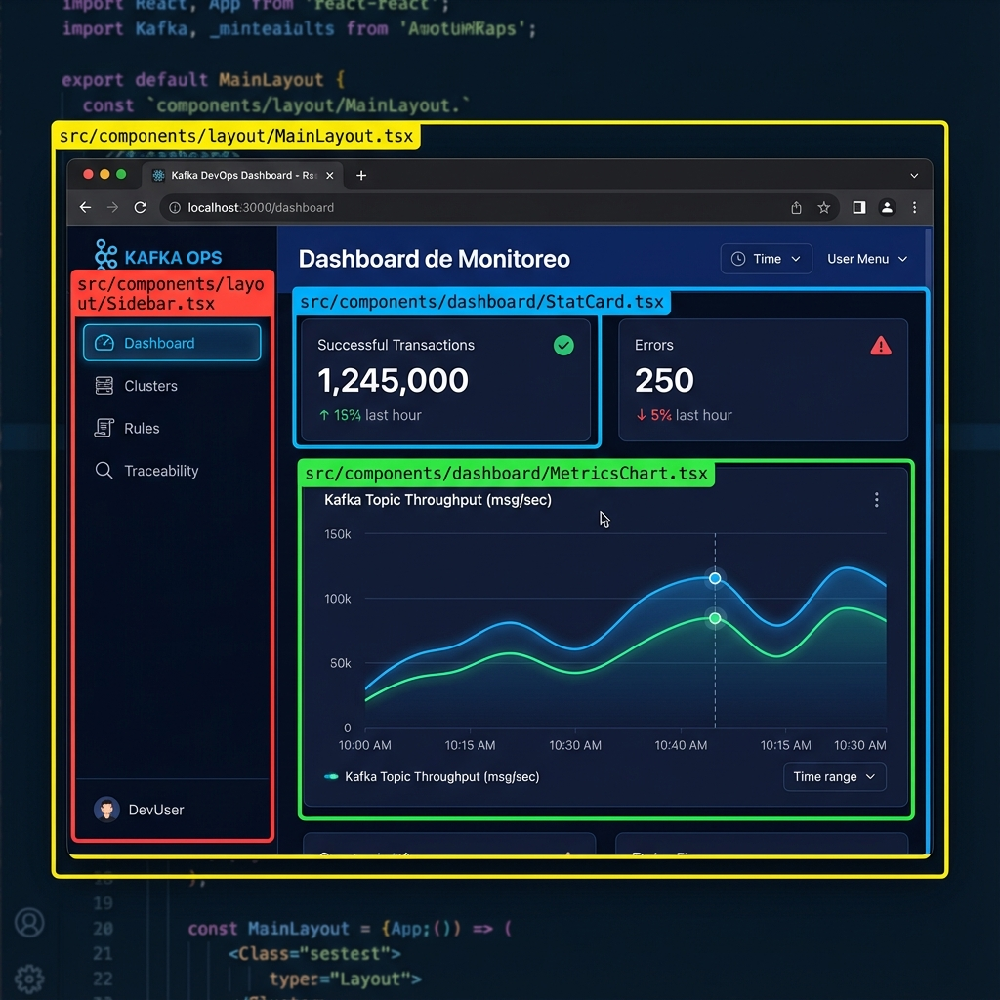

# Arquitectura del Proyecto Frontend

Este documento describe la arquitectura técnica del proyecto `kafka-nexus-hub` y provee una guía visual para navegar por los componentes.

## 🗺️ Guía Visual (Dashboard)

Esta imagen te ayudará a ubicar exactamente qué archivo modifica cada parte de la pantalla principal.



### Referencia de Componentes
| Color | Componente | Archivo | Función |
| :--- | :--- | :--- | :--- |
| **Amarillo** | `MainLayout` | `src/components/layout/MainLayout.tsx` | Marco principal (Fondo, estructura base). |
| **Rojo** | `Sidebar` | `src/components/layout/Sidebar.tsx` | Menú lateral y navegación. |
| **Azul** | `StatCard` | `src/components/dashboard/StatCard.tsx` | Tarjetas de métricas (números grandes). |
| **Verde** | `MetricsChart` | `src/components/dashboard/MetricsChart.tsx` | Gráfico principal de tendencias. |

---

## 🏗️ Visión General Técnica
El proyecto es una **Single Page Application (SPA)** construida con **React 18**, **TypeScript** y **Vite**.

## 🛠️ Stack Tecnológico

### Core & UI
- **[React 18](https://react.dev/)**: Librería UI.
- **[TypeScript](https://www.typescriptlang.org/)**: Tipado estático.
- **[Tailwind CSS](https://tailwindcss.com/)**: Estilos utilitarios.
- **[Shadcn/ui](https://ui.shadcn.com/)**: Componentes base (`src/components/ui`) construidos sobre Radix UI.

### Estado y Datos
- **[TanStack Query](https://tanstack.com/query/latest)**: Server State (Data fetching & caching).
- **[Context API](https://react.dev/reference/react/createContext)**: Client State (Global UI state).
- **[React Router](https://reactrouter.com/)**: Navegación client-side.

## 📂 Estructura de Directorios (`/src`)

La estructura organiza el código por **Funcionalidad** (Features) más que por tipo de archivo:

```
src/
├── components/          
│   ├── ui/              # Átomos reutilizables (Botones, Inputs)
│   ├── layout/          # Sidebar, MainLayout
│   ├── dashboard/       # Componentes exclusivos del Dashboard
│   ├── integration/     # Módulos de Integración
│   └── ...
├── contexts/            # Estado Global (Providers)
├── hooks/               # Custom Hooks
├── pages/               # Vistas principales (Rutas)
├── lib/ & utils/        # Ayudantes y configuración
├── App.tsx              # Configuración de Rutas
└── main.tsx             # Entry Point
```

## 🧩 Patrones Clave

### 1. Composición de UI
La interfaz combina "Átomos" genéricos (`/ui`) con componentes específicos de dominio (`/dashboard`).
- *Ejemplo*: `StatCard` (Dashboard) usa internamente `Card` (UI) y `lucide-react` (Iconos).

### 2. Filosofía de Organización: UI Genérica vs Features (Lego vs Castillo)
Entender la diferencia entre `src/components/ui` y las carpetas de features (como `src/components/dashboard`) es clave:

- **`src/components/ui` (Las Piezas de Lego)**:
  - Son componentes genéricos, reutilizables y "tontos".
  - No saben nada del negocio (no saben qué es una "Transacción Kafka").
  - *Ejemplo*: `ui/chart.tsx` define la configuración base de los gráficos (colores, tooltips) pero no tiene datos.

- **`src/components/dashboard` (El Castillo)**:
  - Son componentes específicos construidos usando las piezas de UI.
  - Tienen lógica de negocio y datos específicos.
  - *Ejemplo*: `dashboard/MetricsChart.tsx` usa `ui/chart` e inyecta los datos de producción y las reglas de color específicas del dashboard.

### 3. Layout Wrapper
Todas las vistas principales viven dentro de `MainLayout`, lo que garantiza que el `Sidebar` sea persistente y no se recargue al navegar.

### 3. Data Fetching
El manejo de datos asíncronos se delega a `React Query` hooks, separando la lógica de obtención de datos de la capa de presentación.

## 🧪 Pruebas Automatizadas (E2E)

El proyecto incluye una suite de pruebas End-to-End (E2E) robusta utilizando **Cypress**. Estas pruebas validan el flujo completo de la aplicación, desde la interacción del usuario hasta la recepción de eventos en tiempo real.

### Arquitectura de Pruebas
La suite de pruebas actúa como un "Robot Usuario" que interactúa con la interfaz mientras un "Controlador de Entorno" manipula el backend.

1.  **Cypress (Robot):** Ejecuta los tests en el navegador, simulando clicks y verificando el DOM.
2.  **Test API (`POST /api/test/trigger`):** Un endpoint dedicado en el Sidecar (Node.js) que permite inyectar eventos Kafka (éxito/error) bajo demanda. Esto elimina la necesidad de depender de productores externos durante las pruebas.
3.  **Selectores Robustos:** Se utilizan atributos `data-testid` en los componentes clave (`StatCard`, `IntegratorCard`) para garantizar que los tests no se rompan con cambios de estilo.

### Escenarios Cubiertos
- **Flujo de Selección:** Navegación desde la landing page hasta el Dashboard seleccionando un integrador.
- **Métricas en Tiempo Real:** Verificación de que los contadores de "Transacciones Exitosas" y "Errores" se actualizan vía WebSocket tras inyectar eventos.
- **Manejo de Errores:** Validación de alertas de expiración, respetando los tiempos de timeout del backend (Window + Cleanup).
- **Visualización de Datos:** Confirmación de que los gráficos (`AreaChart`) renderizan nuevos puntos de datos.

### Ejecución
```bash
# 1. Iniciar Frontend
npm run dev

# 2. Iniciar Sidecar
node server.js

# 3. Ejecutar Tests
npx cypress open
```
